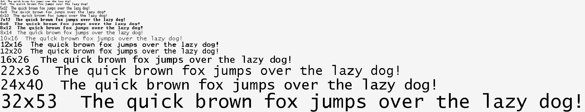

# pntr_pixelfont

Additional small pixel fonts from [uGUI](https://github.com/achimdoebler/UGUI) for use in [pntr](https://github.com/RobLoach/pntr).

## API

``` c
pntr_font* pntr_load_pixelfont(pntr_pixelfont font);
pntr_font* pntr_load_pixelfont_default(void);
pntr_vector pntr_pixelfont_size(pntr_pixelfont font);
```

## Fonts

The following pixel fonts are available. Each has a matching
`PNTR_PIXELFONT_ENABLE_*` macro (`PNTR_PIXELFONT_ENABLE_4X6`, and so on) that
compiles in just that font's bitmap data; `PNTR_PIXELFONT_ENABLE_ALL` enables
every one of them.

- `PNTR_PIXELFONT_4X6`
- `PNTR_PIXELFONT_5X8`
- `PNTR_PIXELFONT_5X12`
- `PNTR_PIXELFONT_6X8`
- `PNTR_PIXELFONT_6X10`
- `PNTR_PIXELFONT_7X12`
- `PNTR_PIXELFONT_8X8`
- `PNTR_PIXELFONT_8X12`
- `PNTR_PIXELFONT_8X14`
- `PNTR_PIXELFONT_10X16`
- `PNTR_PIXELFONT_12X16`
- `PNTR_PIXELFONT_12X20`
- `PNTR_PIXELFONT_16X26`
- `PNTR_PIXELFONT_22X36`
- `PNTR_PIXELFONT_24X40`
- `PNTR_PIXELFONT_32X53`



## Character set

Every font covers **printable ASCII only**: `0x20` (space) through `0x7E`
(tilde), 95 glyphs. That is the same range as pntr's own default font. Any
other character is skipped when drawing and when measuring, apart from `\n`,
which pntr itself handles as a line break.

The uGUI tables these fonts come from hold 256 single-byte glyphs in a
CP437-like arrangement, so there are accented letters and box-drawing
characters in the data. They are not exposed, because a caller can only pick a
glyph through the bytes of the string it draws, and there is no way to name a
glyph above `0x7F` from a UTF-8 string literal with raw single-byte tables.
Restricting the font to ASCII also means it behaves the same whether or not
pntr was built with `PNTR_ENABLE_UTF8`.

## Usage

`pntr_pixelfont.h` does not include [pntr](https://github.com/RobLoach/pntr)
itself: it uses pntr's types and calls into pntr's API, so you include both, in
this order. Each step below exists for a reason, so keep them in sequence.

``` c
// 1. Optional: make one of the pixel fonts pntr's default font. These two
//    defines have to come before pntr's implementation is compiled in step 4,
//    because that is the code that reads PNTR_DEFAULT_FONT. Without
//    PNTR_PIXELFONT_DEFAULT the default pixel font is PNTR_PIXELFONT_4X6.
#define PNTR_PIXELFONT_DEFAULT PNTR_PIXELFONT_8X8
#define PNTR_DEFAULT_FONT pntr_load_pixelfont_default

// 2. pntr.h first, for the types pntr_pixelfont.h is written against
//    (pntr_font, pntr_image, pntr_vector, PNTR_API).
#include "pntr.h"

// 3. pntr_pixelfont.h next, so that pntr_load_pixelfont_default() is declared
//    before pntr's implementation refers to it through PNTR_DEFAULT_FONT.
//    Pick which fonts get compiled in here.
#define PNTR_PIXELFONT_ENABLE_ALL
#include "pntr_pixelfont.h"

// 4. pntr's implementation, which picks up PNTR_DEFAULT_FONT from step 1.
#define PNTR_IMPLEMENTATION
#include "pntr.h"

// 5. pntr_pixelfont's implementation last, since it calls into pntr.
#define PNTR_PIXELFONT_IMPLEMENTATION
#include "pntr_pixelfont.h"

int main() {
    // Load one of the pixel fonts.
    pntr_font* font = pntr_load_pixelfont(PNTR_PIXELFONT_8X12);

    // Generate an image with the text in it.
    pntr_image* image = pntr_gen_image_text(font, "Hello, World!", PNTR_BLACK, PNTR_RAYWHITE);

    // Save the image locally.
    pntr_save_image(image, "pntr_pixelfont_8x12.png");

    // Unload the font and image.
    pntr_unload_image(image);
    pntr_unload_font(font);

    // Thanks to step 1, pntr's own default font is now PNTR_PIXELFONT_8X8.
    pntr_font* defaultFont = pntr_load_font_default();
    pntr_unload_font(defaultFont);

    return 0;
}
```

If you do not want to replace pntr's default font, drop step 1 and the
`pntr_load_font_default()` lines; steps 2 through 5 stay exactly as they are.

The same program lives at
[`examples/pntr_pixelfont_example.c`](examples/pntr_pixelfont_example.c), which
is built by default and with `-DPNTR_PIXELFONT_BUILD_EXAMPLES=ON`, so the
include order above is checked by a compiler.

## License

Unless stated otherwise, all works are:

- Copyright (c) 2023 [Rob Loach](https://robloach.net)

... and licensed under:

- [zlib License](LICENSE)
